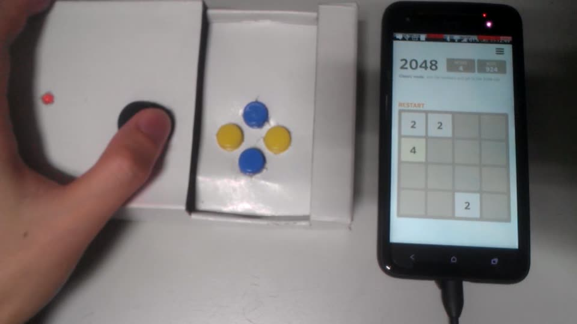

# Android Gamepad (master's thesis, 2014)

My master's thesis and the code that survives from it.

- Title: 設計與實作Android平台上之遊戲控制器 (Design and Implementation of Gamepad over Android Platform)
- Author: 蔡華棣 (Hua-Di Tsai)
- Advisor: 林仁智 (Jen-Chih Lin, Ph.D.)
- School: National Taipei University of Education (國立臺北教育大學), Department of Digital Technology Design, Master Program in Toy and Game Design
- Date: June 2014

**Status: archived historical project, no longer maintained.** Nothing here has been built or tested against current Android versions, and the Android app is incomplete because most of its source was lost (see below).

[Demo video](media/demo-2014.mp4), made in June 2014: 57 seconds, cut down from 2:18 by speeding up the setup screens 3 to 5 times and the gameplay 1.5 times. It has no sound; the captions are the original Chinese ones. It shows connecting the controller, creating a button profile on a screenshot of 2048, playing 2048 with the joystick, then loading the saved profile with the phone in landscape and playing other touch games.

## Why it made sense in 2014

This project solved a problem of its time, and most of that problem has since been solved in other ways. As software it has little practical use today; it is kept as a record of the thesis.

- Phone games were built for touch. Bluetooth controllers already existed, but a game only responded to one if its developer added support. The thesis counted about 35 games for Samsung's Android Wireless Gamepad and about 80 for Gametel. On iOS, Apple had only introduced its standard game controller framework in iOS 7 (2013).
- Android did not let one app tap on another app's screen. The permission for that (`INJECT_EVENTS`) was reserved for the system, so the practical route for a stand-alone app was to root the phone and write touch events directly to the Linux input device, which is what this project did.
- Bluetooth Low Energy had only just reached Android: apps could use it from Android 4.3 (API level 18, July 2013), and many phones in 2014 had neither that version nor the hardware.
- The RFduino, a fingertip-sized Arduino-compatible board with built-in Bluetooth LE, came out of a 2013 Kickstarter campaign. It made a small wireless controller possible on a single board, without a separate Bluetooth module.

## What changed since

- Android 7.0 (API level 24, 2016) added `AccessibilityService.dispatchGesture()`, which lets an app with the user's permission perform taps and swipes in other apps without root.
- Mapping a controller onto screen positions became an ordinary app category. For example, Mantis Gamepad Pro maps most controllers onto touch positions in almost any Android game without root; it is activated through Android's debugging interface (wireless debugging on the phone itself, or a PC on older versions). That is the idea of this thesis, done without its root requirement.
- Bluetooth LE is in every phone, off-the-shelf controllers pair with Android directly, and many games now support them natively.
- The RFduino itself was discontinued after its maker, RF Digital, was acquired.

## The idea

A small Bluetooth 4.0 LE controller built on an RFduino, with four buttons and a dual-axis joystick, plays any touch-screen Android game. In the Android app you load a screenshot of the game and drop the controller's buttons onto the spots you would tap. When a button is pressed, the app writes touch events straight to the Linux input device (`/dev/input/eventN`), so the game sees a finger. Games need no controller support. It requires Android 4.3 or later (for Bluetooth LE) and root access.

The thesis test (table 4-1): touches register with no perceptible delay, the joystick moves the touch point freely inside its circle, the idle controller produces no stray touches, and the connection holds to about 25 m. The prototype cost a US$22.99 RFduino plus under NT$100 of buttons and joystick.

## Abstract

As printed in the thesis:

> Many smartphone games require the player to slide his or her fingers across the screen. However, smartphone users whose fingers exhibit hyperhydrosis not only reduce the sensitivity capacitive touchscreen but also suffer discomfort when sliding fingers on the screen frequently. Meanwhile, Android gamepads, which are the natural alternative to this problem, do not support too many games, because of a lack of cooperation between gamepad makers and game designers. This study, discusses a gamepad that uses analog sticks and buttons to simulate fingerstrokes, which would thereby facilitate a university compatibility with all Android applications, including games, and bypass problems related to capacitive touchscreen interfaces, including hyperhidrosis.

> 市面上的Android 遊戲控制器需要遊戲開發商的配合，而使支援的遊戲數量較多限制。許多智慧型裝置上的遊戲，需要以手指不停的於螢幕上滑動來操作遊戲。對於會流手汗的玩家，手指於螢幕上不停的滑動不但會降低觸控的感應，也容易造成手指的不適。因此本論文製作一遊戲控制器，當遊戲控制器按鈕按下或移動雙軸搖桿時，程式將於Android 裝置模擬手指觸控螢幕，使遊戲控制器支援更多需要觸控的Android 平台遊戲，同時也可以支援非遊戲類型的應用程式。此外，玩家使用遊戲控制器於Android 平台上體驗遊戲時，能減少手指於螢幕觸控時間，降低手指過度頻繁於智慧型裝置螢幕滑動。對於遊戲開發者，也不再受限於遊戲控制器開發商。本論文所開發的遊戲控制器，經過實作驗證，也確實能解決上述問題，對於未來遊戲開發者開發遊戲時也將更為簡單。

## Contents

| Path | What it is |
| --- | --- |
| [`thesis/android-gamepad-thesis-2014.pdf`](thesis/android-gamepad-thesis-2014.pdf) | The full thesis, 52 pages, Traditional Chinese |
| [`media/demo-2014.mp4`](media/demo-2014.mp4) | Sped-up demo video from the thesis defense |
| [`firmware/gamepad/`](firmware/gamepad/gamepad.ino) | Final RFduino sketch that streams the buttons and joystick |
| [`firmware/two-button-prototype/`](firmware/two-button-prototype/two-button-prototype.ino) | Earlier test with two digital buttons |
| [`firmware/analog-read-test/`](firmware/analog-read-test/analog-read-test.ino) | Prints the raw readings of the button and joystick pins over serial |
| [`app-recovered/`](app-recovered/) | The parts of the Android app that could be recovered |

## Firmware

The gamepad sketch sends one integer every 10 ms: the button reading × 1,000,000 + joystick X × 1,000 + joystick Y. The RFduino has only seven GPIO pins, so the four buttons share one analog pin through a resistor ladder (thesis figure 4-9): each button changes the voltage by a different amount, and the app tells them apart by value range.

The two Bluetooth sketches use the RFduinoBLE library (the RFduino 1.7.2 package was in the thesis folder) and started from its `LedButton` example; the analog read test started from Arduino's `AnalogReadSerial` example. All three were kept as `.txt` files in the thesis folder and are saved as `.ino` here, otherwise unchanged.

## Android app (partial)

The Eclipse project `AndroidGamePad` (package `huadi.androidgamepad`) lived in a local Git repository that no longer exists, and no other copy has been found. What survives are the copies that Eclipse's Local History kept. Local History stores the version before each save, so these are late working versions, not necessarily the final code.

- [`BtnConfigActivity.java`](app-recovered/src/huadi/androidgamepad/btnconfig/BtnConfigActivity.java) (2014-05-03): the button layout screen. Start a new profile (loading a saved one is still a TODO in this version), pick a game screenshot as the background, then tap to place Button 1 to 4 or the analog stick; tap a placed button to remove it. Positions are saved in `SharedPreferences`, converted to the touch panel's raw coordinates (0 to 1600 by 0 to 2695 on the 1080 × 1920 test phone), portrait or landscape.
- [`BleDeviceControl.java`](app-recovered/src/huadi/androidgamepad/bluetooth/BleDeviceControl.java) (2014-05-25): receives the controller's values over Bluetooth LE and splits them into button, X and Y. A pressed button touches its saved position; releasing all buttons lifts the touch. Joystick movement beyond a small dead zone becomes a touch that moves within a circle around the stick's position, using the square-to-circle mapping x·√(1 − y²/2) from [Mapping a Square to a Circle](https://mathproofs.blogspot.com/2005/07/mapping-square-to-circle.html).
- [`jni/`](app-recovered/jni/) (2014-02-08): the native touch injection, built with the Android NDK. It is Radu Motisan's Android Event Injector (GPL-2.0-or-later), adapted for this app. My copy had lost its copyright and license notice; the notice is restored with a note of my changes, and [`jni/COPYING`](app-recovered/jni/COPYING) holds the GPL text.

Missing: `Events.java` (the Java side of the native library), `BleService.java`, `BtnValue.java`, `BleStatu.java`, the main activity, layouts, images and `AndroidManifest.xml`. The recovered code does not build on its own.

Traditional Chinese comments were converted from Big5 (CP950) to UTF-8. Apart from that and the restored notices, the files are unchanged.

## Not included

- The signed authorization page and the committee approval page, removed from the PDF because they carry handwritten signatures and personal details. Nothing else in the thesis was changed.
- Drafts, slides, school forms, the full-speed demo and the raw video clips.
- Third-party material from the thesis folder: the RFduino 1.7.2 SDK, the SNES-on-Android-with-original-controller project, a Funduino Joystick Shield example sketch and JNI reference documents.

## License

No open-source license applies to the thesis or to my own code. Do not assume the repository grants any license. The exception is `app-recovered/jni/`, which is GPL-2.0-or-later (see its `COPYING`). Figures that the thesis credits to other sources belong to their owners.
